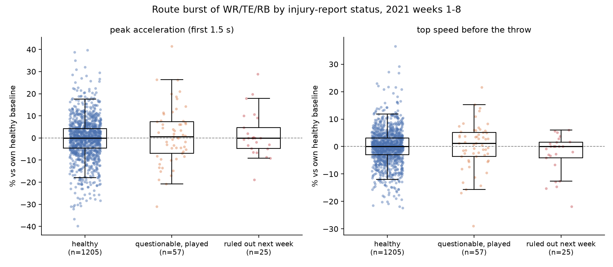
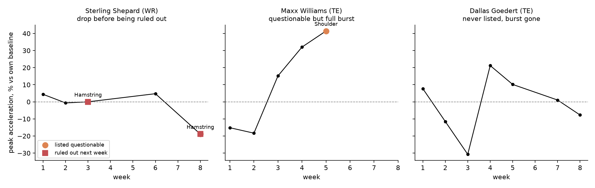

# Burst Watch

A route-burst monitor for NFL receivers, built on Next Gen Stats tracking and checked against the official injury report.

Burst Watch measures route burst for every WR, TE and RB in weeks 1-8 of the 2021 season: peak acceleration in the first 1.5 seconds after the snap and top speed before the throw, taken from the tracking data and compared with each player's own healthy games (median over at least 8 routes per game, baseline from at least 2 games without any injury listing). We overlay the weekly NFL injury report (nflverse, joined through the roster id that matches the tracking `nflId`) to ask whether players listed as Questionable really run at reduced burst, whether a drop already shows in the game before a player is ruled Out, and who is losing burst without ever being listed. The answer is that the label tells you little: the 57 Questionable player-games sit at a median of +0.6 % of baseline peak acceleration, the 25 games played the week before being ruled Out at 0.0 %, both indistinguishable from the 1,205 healthy games (Mann-Whitney p = 0.56 and 0.94), while individual cases such as Sterling Shepard (-19 % peak acceleration in week 8, hamstring, Out the next week) show the drop the report only confirms later. A performance staff would use the per-player timeline as a weekly load and return-to-play check, a coordinator to decide whether a banged-up receiver gets the deep concepts or the flat, and a scout to see if a player's burst is back after an injury. It is a monitor, not a prediction model: small samples, own-baseline normalisation, pre-throw frames only.





## Files

- `scan_tracking.py` - pass over the 122 tracking files, burst per route and per player-game (`output/burst_by_player_game_all.csv`)
- `burst_watch.py` - injury-report join, baseline, burst index, charts, `output/limp_leaderboard.csv` (lowest burst while not listed) and `output/summary_by_status.csv`
- `figures/` - the two charts above

## Run

```
pip install -r requirements.txt
# put the Big Data Bowl data (games.csv, plays.csv, players.csv, pffScoutingData.csv, tracking/) under data/
python scan_tracking.py          # ~10 min, or --weeks 1 for a quick check
python burst_watch.py
```

Design choices: 1.5 s burst window (acceleration phase before the route break); speed and acceleration are taken as delivered by Next Gen Stats; medians instead of means because per-play acceleration is noisy; sacks keep the frames up to the sack, scrambles are dropped; top speed is only counted on plays with at least 1.5 s before the throw so screens do not drag it down.
